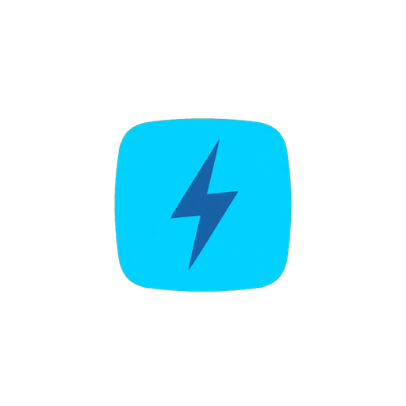

<div align="center">



# ⚡ Spark Bridge

**Ponte PC para agentes de IA** — aplicativo leve (Tauri v2 + Rust) que expõe seu computador para agentes de IA via **MCP (Model Context Protocol)**, com link público gratuito via Cloudflare Quick Tunnel ou **domínio fixo via ngrok**.

</div>

---

## 📑 Índice

- [Sobre](#-sobre)
- [✨ Funcionalidades](#-funcionalidades)
- [📥 Download](#-download)
- [🚀 Início rápido](#-início-rápido)
- [🔌 Conectando clientes MCP](#-conectando-clientes-mcp)
- [🧰 Ferramentas MCP](#-ferramentas-mcp)
- [🌐 API REST](#-api-rest)
- [🖼️ Logo do servidor](#️-logo-do-servidor)
- [❓ Troubleshooting](#-troubleshooting)
- [🔒 Segurança](#-segurança)
- [🛠️ Desenvolvimento](#️-desenvolvimento)
- [📦 Release](#-release)

---

## 📌 Sobre

O **Spark Bridge** roda no seu PC e cria uma ponte segura entre o computador e agentes de IA (como **Gemini Spark**, **Claude**, **Cursor**, **VS Code** e outros clientes MCP). Ao clicar em **Iniciar Conexão**, ele:

1. Sobe um servidor HTTP local (Axum) na porta `4891`;
2. Abre um **túnel público HTTPS gratuito** via Cloudflare Quick Tunnel (`https://....trycloudflare.com`) ou via **ngrok com domínio fixo** (`https://xxx.ngrok-free.app`);
3. Gera um **token de segurança** (`sb_...`) para proteger o acesso;
4. Expõe ferramentas MCP para o agente **ver a tela, controlar mouse/teclado e executar comandos no terminal**.

Tudo isso em um aplicativo desktop leve, com ícone na bandeja do sistema e opção de iniciar com o Windows/Linux/macOS.

---

## ✨ Funcionalidades

| Recurso | Descrição |
|---|---|
| 🔗 **Link público grátis** | URL `https://....trycloudflare.com` gerada automaticamente (baixa o `cloudflared` sozinho se não estiver instalado) |
| 🌐 **Domínio fixo com ngrok** | Use seu authtoken + domínio estático grátis (`xxx.ngrok-free.app`) para uma URL que nunca muda (baixa o `ngrok` sozinho) |
| 🤖 **MCP Streamable HTTP completo** | `POST /mcp` (JSON-RPC 2.0) + `GET /mcp` (stream SSE), com negociação de versão do protocolo (`2025-03-26`, `2025-06-18`, `2024-11-05`), `Mcp-Session-Id`, notificações `202` e CORS com headers MCP expostos |
| 🔐 **Autenticação flexível** | OAuth 2.1/PKCE para clientes remotos como Gemini, além de `?token=...`, `Authorization: Bearer ...` e `X-Api-Key` |
| 🖼️ **Logo do servidor** | `GET /logo.png` (e `/icon.png`) serve o logo oficial embutido no binário, para clientes MCP/agentes que solicitem o ícone |
| 🔍 **Teste de conexão integrado** | Botão **Testar conexão MCP** faz o handshake (`initialize` + `tools/list`) e mostra latência, versão e quantidade de ferramentas |
| ⚙️ **Config pronta por cliente** | Gera o JSON para Claude Desktop, Cursor, VS Code e Gemini CLI com um clique |
| 🖥️ **Controle de tela** | Captura a tela em JPEG (base64, máx. 1600px, com retry anti-frame-vazio) + **URL da captura** para ver no navegador |
| 👁️ **Visão em texto** | `screen_ascii` (prévia ASCII) e `ocr_screen` (palavras + coordenadas via tesseract) para clientes que não repassam imagens |
| 🖱️ **Controle de mouse** | Mover, clicar (esquerdo/direito/meio, duplo), rolar e **arrastar** (drag & drop, selecionar texto) |
| ⌨️ **Controle de teclado** | Digitar texto e pressionar teclas/atalhos (Ctrl, Alt, Shift, Meta) |
| 💻 **Terminal** | Executar comandos no terminal do PC |
| 📋 **Área de transferência** | Ler e escrever o clipboard do sistema |
| 🖥️ **Info da tela** | Resolução e monitores (para calibrar coordenadas) |
| 🔗 **Abrir URL** | Abre links http(s) no navegador padrão |
| ⏳ **Esperar** | Pausa por N ms (útil após abrir apps) |
| 🔄 **Executar em segundo plano** | Minimiza para a bandeja do sistema ao fechar a janela |
| 🚀 **Iniciar com o sistema** | Abre automaticamente quando o PC ligar |
| 🔑 **Regenerar token** | Gera um novo token de segurança a qualquer momento |
| 🛡️ **Aba Segurança** | Permite ou bloqueia individualmente cada ferramenta disponível ao agente |

---

## 📥 Download

Baixe o instalador para o seu sistema na aba [**Releases**](https://github.com/Pedro21062014/spark-bridge/releases):

| Sistema | Arquivos |
|---|---|
| **Linux** | `.deb`, `.AppImage`, `.rpm` |
| **Windows** | `.exe` (instalador), `.msi` |
| **macOS** | `.dmg` (Apple Silicon) |

> **Requisitos:** nenhum software extra é necessário — o `cloudflared` é baixado automaticamente na primeira conexão.

---

## 🚀 Início rápido

1. Abra o **Spark Bridge** e clique em **Iniciar Conexão**.
2. Aguarde o status ficar **Online** (o túnel pode levar alguns segundos).
3. Copie o campo **URL Completa para MCP / Agente** — ela termina em `/mcp?token=sb_...`.
4. Na seção **Configuração do cliente MCP**, escolha seu cliente e copie o JSON gerado.
5. Cole a configuração no cliente MCP e reconecte.

> ⚠️ **Importante:** URLs do Cloudflare Quick Tunnel **mudam a cada início** do aplicativo. Sempre copie a URL nova após reconectar. Para uma **URL fixa**, use o ngrok (veja abaixo).

### 🌐 Domínio fixo com ngrok (opcional)

1. Crie uma conta grátis em [ngrok.com](https://ngrok.com) e acesse o [dashboard](https://dashboard.ngrok.com).
2. Copie seu **Authtoken** (dashboard → *Your Authtoken*).
3. Em **Domains**, reclame seu **domínio estático grátis** (ex.: `meu-bridge.ngrok-free.app`).
4. No Spark Bridge, na seção **Túnel (URL pública)**, selecione **ngrok**, cole o authtoken e o domínio, e clique em **Salvar túnel**.
5. Clique em **Iniciar Conexão** — a URL pública será sempre a do seu domínio.

> O `ngrok` é baixado automaticamente na primeira vez. O authtoken fica salvo **apenas neste PC** (arquivo local com permissão restrita). O plano gratuito do ngrok tem limites (ex.: 1 agente online) — para uso pessoal é suficiente.

---

## 🔌 Conectando clientes MCP

O Spark Bridge suporta dois formatos de autenticação:

- **URL completa:** `https://SEU-TUNEL.trycloudflare.com/mcp?token=sb_SEU_TOKEN` (funciona em qualquer cliente que aceite só URL);
- **URL base + header:** URL `https://SEU-TUNEL.trycloudflare.com/mcp` + header `Authorization: Bearer sb_SEU_TOKEN` (recomendado quando o cliente suporta headers).

### Claude Desktop (`claude_desktop_config.json`)

```json
{
  "mcpServers": {
    "spark-bridge": {
      "command": "npx",
      "args": ["-y", "mcp-remote", "https://SEU-TUNEL.trycloudflare.com/mcp", "--header", "Authorization: Bearer sb_SEU_TOKEN"]
    }
  }
}
```

### Cursor (`.cursor/mcp.json`)

```json
{
  "mcpServers": {
    "spark-bridge": {
      "url": "https://SEU-TUNEL.trycloudflare.com/mcp",
      "headers": { "Authorization": "Bearer sb_SEU_TOKEN" }
    }
  }
}
```

### VS Code (`.vscode/mcp.json`)

```json
{
  "servers": {
    "spark-bridge": {
      "type": "http",
      "url": "https://SEU-TUNEL.trycloudflare.com/mcp",
      "headers": { "Authorization": "Bearer sb_SEU_TOKEN" }
    }
  }
}
```

### Gemini CLI (`~/.gemini/settings.json`)

> ⚠️ No Gemini, use o **token na URL** (`?token=...`). O Gemini CLI nem sempre envia headers customizados — sem o token, o servidor responde `401` e o Gemini pede **OAuth** (que o Spark Bridge não usa).

```json
{
  "mcpServers": {
    "spark-bridge": {
      "httpUrl": "https://SEU-TUNEL.trycloudflare.com/mcp?token=sb_SEU_TOKEN"
    }
  }
}
```

> 💡 A interface do app gera essas configurações automaticamente com a URL e o token atuais — basta escolher o cliente e copiar.

---

## 🧰 Ferramentas MCP

O servidor expõe **15 ferramentas** via `tools/list` / `tools/call`:

| Ferramenta | Parâmetros | Descrição |
|---|---|---|
| `screen_capture` | — | Captura a tela principal em JPEG (base64, máx. 1600px; retorna também um bloco de texto com as dimensões) |
| `mouse_move` | `x`, `y` | Move o cursor para as coordenadas (x, y) |
| `mouse_click` | `x?`, `y?`, `button?` (`left`/`right`/`middle`), `double?` | Clica (opcionalmente em x, y) |
| `mouse_scroll` | `delta_x?`, `delta_y?` | Rola a roda do mouse |
| `keyboard_type` | `text` | Digita o texto |
| `keyboard_key` | `key`, `modifiers?` (`ctrl`, `alt`, `shift`, `meta`) | Pressiona uma tecla/atalho |
| `terminal_exec` | `command`, `cwd?` | Executa um comando no terminal e retorna stdout/stderr/exit_code |
| `mouse_drag` | `x1`, `y1`, `x2`, `y2`, `button?` | Arrasta o mouse de (x1, y1) para (x2, y2) segurando o botão |
| `get_screen_info` | — | Retorna monitores (nome, resolução, principal) |
| `clipboard_read` | — | Lê o texto da área de transferência |
| `clipboard_write` | `text` | Escreve texto na área de transferência |
| `open_url` | `url` | Abre uma URL http(s) no navegador padrão |
| `wait` | `ms` (máx. 30000) | Aguarda N milissegundos |
| `screen_ascii` | — | Prévia da tela em arte ASCII (texto) — para clientes sem suporte a imagem |
| `ocr_screen` | — | OCR da tela (requer `tesseract`): palavras visíveis com coordenadas (x, y) reais |

Métodos JSON-RPC suportados: `initialize`, `ping`, `tools/list`, `tools/call`, `resources/list`, `resources/templates/list`, `prompts/list`, `logging/setLevel` e notificações (`notifications/*` → `202`).

---

## 🌐 API REST

Além do MCP, o servidor expõe endpoints REST (todos exigem token, exceto os públicos):

| Método | Endpoint | Auth | Descrição |
|---|---|---|---|
| `GET` | `/health` | ❌ pública | Status do servidor (`{"status":"ok","version":"...","logo":"/logo.png"}`) |
| `GET` | `/logo.png` | ❌ pública | Logo oficial do Spark Bridge (PNG) |
| `GET` | `/icon.png` | ❌ pública | Alias do logo |
| `GET` | `/openapi.json` | ❌ pública | Especificação OpenAPI 3.0 |
| `POST` | `/mcp` | ✅ | MCP Streamable HTTP (JSON-RPC 2.0) |
| `GET` | `/mcp` | ✅ | Stream SSE do MCP (server → client) |
| `DELETE` | `/mcp` | ✅ | Encerra a sessão MCP |
| `GET` | `/screen` | ✅ | Captura de tela em JPEG (base64, máx. 1600px) |
| `POST` | `/mouse/move` | ✅ | `{"x": 100, "y": 200}` |
| `POST` | `/mouse/click` | ✅ | `{"x": 100, "y": 200, "button": "left", "double": false}` |
| `POST` | `/mouse/scroll` | ✅ | `{"delta_y": -3}` |
| `POST` | `/keyboard/type` | ✅ | `{"text": "olá"}` |
| `POST` | `/keyboard/key` | ✅ | `{"key": "s", "modifiers": ["ctrl"]}` |
| `POST` | `/terminal/exec` | ✅ | `{"command": "ls", "cwd": "/home/user"}` |
| `POST` | `/mouse/drag` | ✅ | `{"x1": 100, "y1": 100, "x2": 400, "y2": 300}` |
| `GET` | `/screen/info` | ✅ | Info dos monitores (resolução, principal) |
| `GET` | `/clipboard` | ✅ | Lê o clipboard |
| `POST` | `/clipboard` | ✅ | `{"text": "copiado"}` |
| `POST` | `/open-url` | ✅ | `{"url": "https://exemplo.com"}` |
| `GET` | `/screenshot.jpg` | ✅ | Última captura em JPEG (para ver no navegador) |
| `GET` | `/screen/ocr` | ✅ | OCR da tela: palavras + coordenadas (requer `tesseract`) |

**Exemplo (curl):**

```bash
# Health check (sem token)
curl https://SEU-TUNEL.trycloudflare.com/health

# Captura de tela (com token na URL)
curl "https://SEU-TUNEL.trycloudflare.com/screen?token=sb_SEU_TOKEN"

# Captura de tela (com header)
curl -H "Authorization: Bearer sb_SEU_TOKEN" https://SEU-TUNEL.trycloudflare.com/screen
```

---

## 🖼️ Logo do servidor

O logo oficial do Spark Bridge fica **embutido no binário** e é servido pelo servidor HTTP:

- `GET /logo.png` → logo oficial (PNG, `image/png`, cache de 1 dia)
- `GET /icon.png` → alias do logo
- `GET /health` → inclui `"logo": "/logo.png"`
- `GET /openapi.json` → inclui `info.x-logo.url = "/logo.png"`

Assim, **qualquer cliente MCP, agente ou ferramenta que solicite o logo/ícone do servidor recebe o logo oficial automaticamente**, sem depender de links externos.

---

## ❓ Troubleshooting

### Erro: “Não foi possível acessar o servidor MCP. Revise o URL”

Esse erro significa que o cliente não conseguiu completar o handshake MCP. Verifique, nesta ordem:

1. **Use a URL com `/mcp`:** `https://....trycloudflare.com/mcp?token=sb_...` (não apenas `/`).
2. **Token atualizado:** a URL e o token mudam a cada início do app — copie novamente após reconectar.
3. **Status Online:** o Spark Bridge precisa estar com status **Online** e o túnel ativo.
4. **Teste integrado:** clique em **Testar conexão MCP** no app. Se falhar, o problema está no servidor local/túnel, não no cliente.
5. **Header vs. query:** se o cliente suporta headers, use a URL base (`.../mcp`) + `Authorization: Bearer <token>`. Se não suporta, use a URL completa com `?token=...`.
6. **Health check:** abra `https://....trycloudflare.com/health` no navegador — deve retornar `{"status":"ok",...}`.

### Erro 401 (Unauthorized)

Token inválido ou ausente. Confira se copiou o token atual (ele muda a cada início) ou use o botão **↻ Novo** para gerar um novo token e atualize a configuração do cliente.

### Gemini: “usa um método de autenticação que o Gemini não aceita / exige OAuth”

O Spark Bridge agora publica descoberta OAuth (`/.well-known/oauth-protected-resource` e `/.well-known/oauth-authorization-server`), autorização com PKCE e troca de código por access token e refresh token. Na tela **Conectar-se a um servidor MCP** do Gemini, use a URL pública terminando em `/mcp` e abra **Configurações avançadas**. Preencha **ID do cliente OAuth** e **Chave secreta do cliente OAuth** com os valores que o Spark Bridge mostra na configuração do cliente MCP; a URI de redirecionamento deve ser a URI copiada pelo próprio Gemini. Depois conclua a tela **Autorizar o Spark Bridge**. O retorno usa um redirect HTTP 302, para que o callback do Gemini receba o código via GET. Para o Gemini CLI, a URL com `?token=` continua disponível e a configuração também aceita header Bearer.

Na aba **Segurança**, escolha as ferramentas que podem ser usadas. O servidor bloqueia chamadas MCP desativadas, mesmo que o cliente tente invocá-las diretamente.

### O túnel não conecta / timeout

O Spark Bridge só exibe **Online** depois de confirmar o servidor local e o endpoint público em `/health`. Se o ngrok encerrar, a conexão não é marcada como Online e a mensagem inclui os últimos logs do processo.

- Verifique sua conexão com a internet;
- O `cloudflared` é baixado automaticamente na primeira vez — aguarde o download;
- Feche outros túneis/servidores que possam estar usando a porta `4891`;
- Desative VPN/proxy temporariamente para testar.

### A URL mudou depois de reiniciar o app

Comportamento esperado: o Cloudflare Quick Tunnel gera uma URL nova a cada conexão. Copie a URL atual na interface e atualize a configuração do cliente MCP. Para uma URL fixa, use o **ngrok com domínio estático** (veja a seção acima).

### Erros do ngrok (authtoken/domínio)

- **Authtoken inválido:** confira se copiou o token completo do dashboard (sem espaços).
- **Domínio em uso / não encontrado:** o domínio precisa estar reclamado na sua conta ngrok (*Domains*).
- **Limite do plano gratuito:** o ngrok free permite 1 agente online — feche outros túneis ngrok antes de conectar.
- **Página de aviso do ngrok no navegador:** o plano gratuito pode exibir um aviso em navegadores; clientes MCP (não-navegador) acessam normalmente.

### Captura de tela falha (Linux)

No Linux, a captura usa PipeWire/X11. Em sessões Wayland restritas, pode ser necessário conceder permissão de captura de tela ao aplicativo.

### A IA diz que a captura da tela está “vazia”

Isso acontece quando o cliente MCP descarta a imagem ou quando o frame capturado vem preto. O Spark Bridge já mitiga isso:

- A captura é devolvida em **JPEG reduzido (máx. 1600px)** em vez de PNG em resolução total — PNGs de vários MB costumam ser truncados/descartados pelos clientes;
- Frames **pretos/vazios são detectados e tentados novamente** (até 3x) antes de responder;
- Se a captura falhar de verdade, a ferramenta retorna um **erro explicativo** (tela bloqueada/desligada, permissão Wayland etc.) em vez de uma imagem vazia.

Se ainda assim a IA relatar captura vazia, verifique: tela ligada e desbloqueada, permissão de captura de tela concedida (Linux/Wayland) e se o cliente MCP suporta conteúdo de imagem (`image/jpeg`).

> **A IA recebe só a confirmação (“Screenshot 1600x...”) e não a imagem?** Isso indica que o **cliente MCP não repassa imagens ao modelo** (alguns clientes/agentes web são só-texto). O servidor já envia a imagem como **primeiro bloco** do resultado para maximizar compatibilidade. Para esses clientes, o Spark Bridge oferece **visão em texto**:
> - `screen_ascii` — prévia da tela em arte ASCII (layout para decidir onde clicar/rolar);
> - `ocr_screen` — palavras visíveis com coordenadas (x, y) reais (requer `tesseract` instalado: Windows `winget install UB-Mannheim.TesseractOCR`, Linux `sudo apt install tesseract-ocr`, macOS `brew install tesseract`);
> - `GET /screenshot.jpg` — a última captura em JPEG, para **você** ver o print no navegador (o link com token vem no texto do `screen_capture`).
>
> Para a IA *analisar* a imagem diretamente, use um cliente com suporte a imagens em resultados MCP — ex.: **Claude Desktop**, **VS Code (Copilot)**, **Cursor** ou **Gemini CLI**.

---

## 🔒 Segurança

- O acesso ao servidor é protegido por **token** (`sb_...`) gerado a cada início do app;
- O túnel usa **HTTPS** (Cloudflare), então o tráfego é criptografado;
- O servidor escuta apenas em `127.0.0.1` (localhost) — o acesso externo acontece **somente** pelo túnel;
- **Nunca compartilhe** a URL com token nem o token em si;
- Para encerrar o acesso, clique em **Parar Conexão** ou feche o aplicativo;
- Use o botão **↻ Novo** para invalidar o token atual e gerar um novo.

---

## 🛠️ Desenvolvimento

### Pré-requisitos

- [Node.js](https://nodejs.org/) 20+
- [Rust](https://www.rust-lang.org/tools/install) (stable)
- Dependências do sistema (Linux): `libwebkit2gtk-4.1-dev`, `libappindicator3-dev`, `librsvg2-dev`, `patchelf`, `libxdo-dev`, `libxcb1-dev`, `libxrandr-dev`, `libdbus-1-dev`, `libssl-dev`, `libgtk-3-dev`, `libpipewire-0.3-dev`, `libclang-dev`, `libgbm-dev`

### Comandos

```bash
npm install          # instala deps do frontend (Tauri CLI)
npx tauri dev        # roda o app em modo desenvolvimento
npx tauri build      # gera os instaladores em src-tauri/target/release/bundle/
```

### Testes

```bash
cd src-tauri
cargo check          # verificação de tipos
cargo test --lib     # teste de integração MCP (handshake, SSE, auth, logo)
```

### Estrutura do projeto

```
spark-bridge/
├── .github/workflows/   # CI + release (tags v*)
├── ui/                  # Interface (HTML/CSS/JS)
├── src-tauri/
│   ├── icons/           # icon.png (logo oficial) + ícones gerados
│   ├── src/
│   │   ├── lib.rs       # Comandos Tauri, tray, estado, teste de conexão
│   │   ├── server.rs    # Servidor HTTP (MCP Streamable HTTP + REST + logo)
│   │   └── tunnel.rs    # Download e gerenciamento do cloudflared
│   ├── Cargo.toml
│   └── tauri.conf.json
├── package.json
└── README.md
```

---

## 📦 Release

As releases são criadas pelo workflow **Build & Release Spark Bridge** (`.github/workflows/release.yml`) a partir de tags `v*`:

```bash
# 1. Atualize a versão em package.json, src-tauri/Cargo.toml e src-tauri/tauri.conf.json
# 2. Commit e push na main
git push origin main
# 3. Crie e envie a tag
git tag v0.20.0
git push origin v0.20.0
```

O workflow compila para Linux, Windows e macOS e publica os instaladores na aba Releases. Também é possível rodar manualmente em **Actions → Build & Release Spark Bridge → Run workflow** informando a tag.

O workflow **CI** (`.github/workflows/ci.yml`) roda a cada push/PR na `main`: `cargo check`, `cargo test` (teste MCP) e verificação de sintaxe do frontend.

---

<div align="center">

Feito com ⚡ por Spark Bridge · Tauri + Rust · MCP Streamable HTTP

</div>


### URI de redirecionamento do Gemini

Na tela de conexão do Gemini, copie a URI de redirecionamento, cole-a no campo **URI de redirecionamento do Gemini** dentro do Spark Bridge e clique em **Salvar URI** antes de concluir a autorização.
